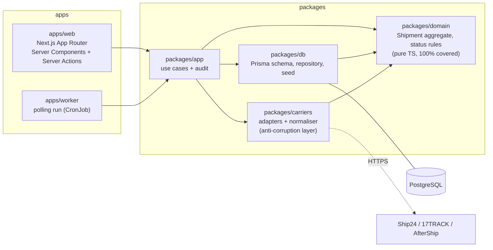

# Handoff Tracker

Follows parcels across carrier handoffs (e.g. **4PX in China → Sagawa in Japan**), flags shipments
that go quiet, and gives staff one place to look instead of two carrier websites.


_All data in this repo and in the demo is fake. Order numbers start with `DEMO-`._

## The problem

When 4PX hands a parcel to Sagawa for the last mile, the 4PX page goes quiet and Sagawa uses a new
tracking number. Parcels that stall between the two are easy to miss until a customer asks.
Handoff Tracker models each **Leg** and the **Handoff** between them explicitly, so a parcel that
4PX handed over but Sagawa never picked up shows up on the stuck dashboard after 5 days.

## What it does

- **Stuck dashboard**: no event for 3 days (5 straight after a handoff), by carrier and days quiet.
- **Timeline per shipment**, grouped by Leg, with handoff markers and a "last checked" time so
  "no news" can be trusted.
- **Polling worker**: fetches events through carrier/aggregator adapters, follows handoffs to
  the next carrier's tracking number, and backs off on 429s.
- **Operators** add manual events and notes, record handoffs, override status (reason required),
  and mark stuck parcels resolved. **Everything is audited.**
- **CSV import** (Shopify or simple CSV) with a preview of per-row errors. Re-importing updates
  orders and never duplicates them.
- **Privacy**: customer name and postcode are masked by default, and every reveal or print is audited.
- Company **Google sign-in** with viewer/operator/admin roles, **packing slip and label** printing,
  **English and Japanese** UI, and a **trial metrics** page.

## Architecture



- **Domain-driven**: `Order`, `Shipment`, `Leg`, `Handoff`, `TrackingEvent` and `AuditEntry` are the
  words staff use and the names in the code. All status and stuck rules live in `packages/domain`
  as pure functions. Nothing in React or SQL decides them.
- **Anti-corruption layer**: carrier quirks (Japanese Sagawa messages, aggregator codes) stay in
  `packages/carriers`. Adapters only translate.
- **One audit path**: every change goes through `writeAudit` inside the same transaction.

## Quick start

Requires Node 24, Docker and pnpm (`corepack enable`).

```sh
pnpm install
cp .env.example .env
pnpm db:setup   # Postgres on :5433, migrations, 54 fake orders
pnpm dev        # http://localhost:3100 (developer login: pick a seeded user)
pnpm worker     # one polling run against the fake carriers; DEMO-LIVE-* shipments fill in
```

Other ways to run it:

- **Containers**: `docker compose --profile app up --build`, then open http://localhost:3200
- **Kubernetes**: `./scripts/kind-up.sh` gives you kind + Argo CD syncing the Helm chart, at
  http://localhost:8095 ([docs/kubernetes.md](docs/kubernetes.md))
- **Private deployment** for a real trial: [docs/deployment.md](docs/deployment.md)
- **CKA practice**: [`cka/`](cka/README.md) is a three-node v1.35 cluster running this app, with
  27 auto-graded exam-style tasks covering the whole CKA curriculum, including troubleshooting
  scenarios that break the app on purpose

## Quality

|               |                                                                                                     |
| ------------- | --------------------------------------------------------------------------------------------------- |
| `pnpm verify` | Prettier, ESLint, TypeScript (strict), unit and use-case tests, the same as CI                      |
| Domain        | Vitest with coverage thresholds (100% lines/functions, 95% branches)                                |
| Use cases     | Vitest against a real Postgres test database                                                        |
| End to end    | Playwright: import, timeline, resolve a stuck shipment, auth, privacy, documents, Japanese          |
| Security      | Trivy on dependencies, secrets, Dockerfiles and both images; Dependabot; [SECURITY.md](SECURITY.md) |
| Delivery      | GitHub Actions → GHCR images → tag committed to Helm values → Argo CD                               |

Work is tracked as one issue per feature and one PR per issue, with CI green before merge.

## Decisions

- [ADR-0001: Project scope and stack](docs/adr/0001-project-scope-and-stack.md)
- [ADR-0002: Status model and explicit handoffs](docs/adr/0002-status-model-and-explicit-handoffs.md)
- [ADR-0003: Tracking aggregator](docs/adr/0003-tracking-aggregator.md) (proposed, pending the trial)

## Layout

| Path                | What                                                                              |
| ------------------- | --------------------------------------------------------------------------------- |
| `apps/web`          | Next.js app (App Router, Server Components, Server Actions)                       |
| `apps/worker`       | Polling worker                                                                    |
| `packages/domain`   | Pure TypeScript domain model and rules                                            |
| `packages/app`      | Use cases shared by web and worker; the audit helper                              |
| `packages/carriers` | Carrier and aggregator adapters, normaliser                                       |
| `packages/db`       | Prisma schema, migrations, repository, fake-data seed                             |
| `e2e`               | Playwright tests                                                                  |
| `infra`             | Dockerfiles, Compose for production, Helm chart, kind config, Argo CD Application |
| `docs`              | ADRs, deployment and Kubernetes notes                                             |

## What I would do next

1. **Run the aggregator trial** with real numbers and settle ADR-0003. Then fix whatever the real
   responses teach the adapters, and grow the Sagawa message mapping from the "unrecognised" events.
2. **Two-week internal trial** at Comfort Works, measuring check times so the metrics page reports
   measured numbers instead of assumptions.
3. **A NOMS export shape** for the importer, so staff can import without reformatting.
4. **Notifications**: a daily digest of newly stuck shipments to a Slack channel or email.
5. **Slimmer worker image**: bundle the worker instead of shipping the workspace with dev dependencies.
6. **Webhooks instead of polling** where the chosen aggregator supports them.

## Out of scope

Scraping carrier sites or bypassing CAPTCHAs; automatic messages to customers; writing back to
Shopify or NOMS; multi-tenant SaaS; ML delay prediction. See [ADR-0001](docs/adr/0001-project-scope-and-stack.md).
