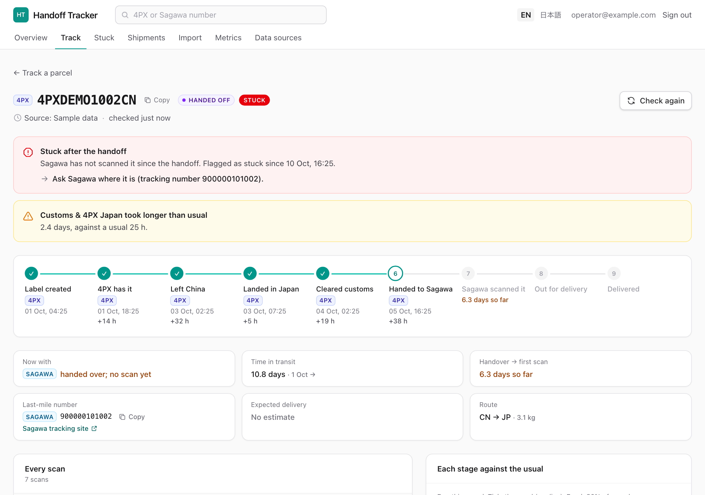

# Request: 4PX tracking API access for Handoff Tracker

**The ask:** enable 4PX Open Platform API access (the tracking service, `tr.order.tracking.get`)
on our 4PX merchant account, and let us have the AppKey and AppSecret (test and production).
4PX's documentation lists the tracking API as free for its customers †.

† Marked items come from 4PX's public documentation and are confirmed with real keys in the trial
below. Nothing in this note depends on them being true for the request to be worth making.

## The problem

Our parcels from China travel with 4PX, then 4PX hands them to Sagawa for delivery in Japan. After
the handover:

- 4PX's tracking page goes quiet, and the parcel continues under a **new Sagawa tracking number**.
- To find a parcel, staff open 4PX's site, find the Sagawa number, then open Sagawa's site:
  about **4 minutes per check** (our estimate; to be replaced with a measured time).
- Parcels that stall between the two carriers are easy to miss until a customer complains.

## What Handoff Tracker already does

Run `pnpm demo` (see [demo-script.md](demo-script.md)). Everything shown is demo data
(`DEMO-` orders, `4PXDEMO` numbers); no customer data is in the repository.

- **Overview** for the whole team: where open parcels are, where the time goes (China, flight,
  customs, handoff, Sagawa), how long Sagawa takes to scan after 4PX hands over, deliveries per week,
  and the parcels that need someone today.
- **Stuck list** with the next step for each parcel ("Ask Sagawa where it is, tracking number …").
- **Live lookup** of any 4PX or Sagawa number: the whole journey across both carriers, each stage
  against the usual, the handoff gap, an expected delivery date from our own history, and what to do.
- **Japanese and English** throughout; every change is in an audit log.

## What 4PX's API adds

| Question staff ask                         | Today (by hand)         | With an aggregator               | With 4PX's API                                                  |
| ------------------------------------------ | ----------------------- | -------------------------------- | --------------------------------------------------------------- |
| Which Sagawa number has our parcel?        | copy it from 4PX's site | sometimes                        | yes, `serverNum` †                                              |
| …before the handover happens?              | no                      | no                               | yes, once 4PX assigns it †                                      |
| Why is it held (customs, address, absent)? | free text               | free text                        | one of 4PX's 429 status codes                                   |
| Has 4PX handed it over yet?                | read the wording        | depends on the aggregator        | yes: code `FPX_D_STPP` (handover), `FPX_O_RR` (Sagawa received) |
| Cost and limits                            | staff time              | 10–200 free parcels, then paid ¹ | free for 4PX customers †, no parcel limit                       |

¹ Ship24: 10 parcels/month free, paid plans from $39/month per 1,000 parcels. 17TRACK: 200 numbers
once for new accounts, then paid. AfterShip: no free API tier, from about $59/month. (Each
provider's pricing page, October 2026.)

## Cost, effort and risk

- **Cost:** none expected from 4PX †. No new software to buy or run.
- **Effort:** the 4PX client is already written and tested against 4PX's documented format
  (including 4PX's own signing example). Switching on is two settings (`FOURPX_APP_KEY`,
  `FOURPX_APP_SECRET`) and a one-hour trial on 10 real numbers.
- **Risk:** low. The API is read-only for tracking. Keys are stored only in the server's settings,
  never in the code or the database. If the keys turn out not to cover our parcels, nothing is lost:
  the app keeps working with the aggregators and by hand.

## How we get the keys

1. Our 4PX account holder logs in at **open.4px.com** as a 4PX merchant.
2. Completes identity verification and accepts the open platform agreement online.
3. Creates an application and ticks the tracking service. 4PX reviews it (3–5 working days in
   4PX's older guide).
4. Copies the test and production AppKey/AppSecret to us securely (a password manager, not email).

If our parcels are booked under another company's 4PX account (for example a forwarder), the keys
must come from that account, or that company grants us access through 4PX's partner (OAuth) route.

## What to send our 4PX account manager

> Hello, we would like to use the 4PX Open Platform API to track our own shipments
> (`tr.order.tracking.get`). Could you enable API access for our merchant account, and confirm that
> for our Japan channel (S5058) the tracking response includes the last-mile carrier and its
> tracking number (`serverName`, `serverNum`)? Thank you.

## The trial (after the keys arrive)

`pnpm trial:4px` runs 10 real numbers through 4PX and any configured aggregator and prints one table.
We switch the app over if, for those 10 parcels:

- 4PX names Sagawa's number for at least 9;
- the handover time and Sagawa's first scan can be read from 4PX's codes;
- fewer than 5% of 4PX's codes are unrecognised by the app.

Technical background: [ADR-0004](adr/0004-direct-4px-integration.md).

---

### 要約（日本語）

4PXの追跡API（tr.order.tracking.get）を当社の加盟店アカウントで利用できるよう、4PXに依頼したいと考えています。4PXの公開資料ではAPIは4PX顧客向けに無料で、国内配送業者（佐川）の追跡番号を返す項目（serverNum）があります。これにより、現在手作業で行っている「4PXのサイトで佐川の番号を調べ、佐川のサイトで確認する」作業（1件約4分の見積もり）が不要になり、業者間で止まっている荷物を早く見つけられます。アプリ側の対応は実装・テスト済みで、キー2つを設定するだけで有効になります。
